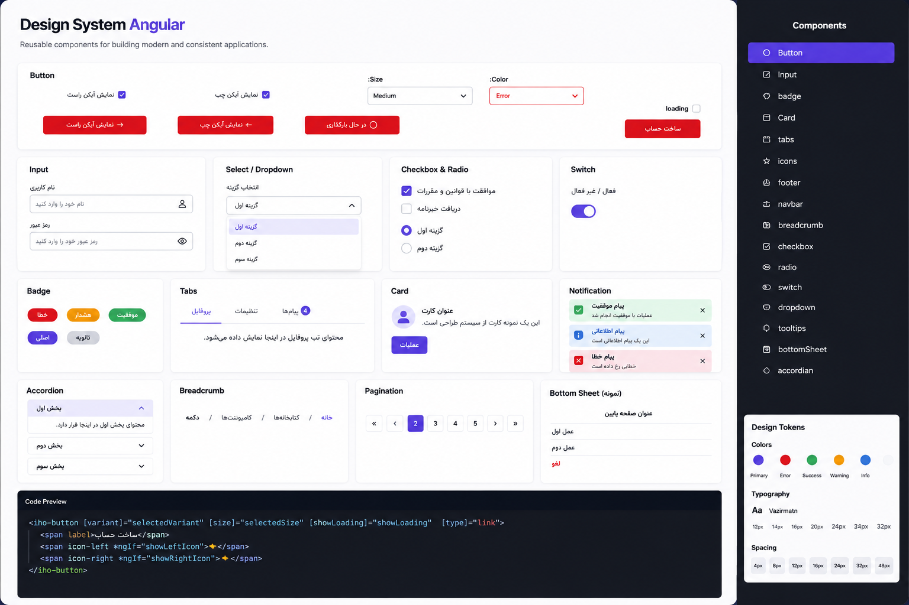

# MyTag Design System Angular

<p align="center">
  
</p>

<p align="center">
  MyTag: a reusable, token-based Angular design system built for enterprise applications.
</p>

<p align="center">
  Angular 16 · TypeScript · SCSS · Angular Material · Responsive · RTL-first
</p>

## Overview

This workspace contains:

- `design-system`: the publishable component library.
- `admin-panel`: an RTL showcase and integration application for the library.

The latest component styles use shared design tokens for color, typography,
spacing, border radius, border width, and elevation. The showcase includes
updated examples for the supported component states and variants.

## Features

- Modular Angular components and per-component NgModules
- Shared CSS custom-property design tokens
- Angular-inspired showcase branding, separate from the library's component tokens
- SCSS styling and packaged Ravi FaNum typography
- RTL-first layouts
- Responsive component behavior
- Form controls with Angular Forms integration
- Packaged icons, fonts, images, and Sass assets
- Interactive showcase with usage examples
- Strict TypeScript and Angular template checking

## Requirements

- Node.js and npm
- Angular 16.2-compatible application

## Installation

```bash
npm install @mytag/design-system
```

The package name is `@mytag/design-system`; `mytag-` is the component tag prefix.
Version v0.6.0 renames 24 branded TypeScript exports to the `Mytag` prefix.
Version v0.5.0 moved the package to the `@mytag` scope. Update package dependencies,
all TypeScript imports, and any `node_modules` asset paths to the new package name.
Component selectors and design tokens are unchanged by the package rename.
This release includes the redesigned showcase, complete component examples, icon
catalogue, and color-token explorer. Upgrading from v0.2.1 also requires the
migration described below. The
built library is also available as an installable GitHub Release asset:

```bash
npm install https://github.com/abbasi-milad1372/design-system-angular/releases/download/v0.6.0/mytag-design-system-0.6.0.tgz
```

## Usage

Import only the modules required by your application:

```typescript
import { NgModule } from '@angular/core';
import { MytagButtonModule } from '@mytag/design-system';

@NgModule({
  imports: [MytagButtonModule],
})
export class AppModule {}
```

Then use the component in a template:

```html
<mytag-button><span label>ثبت درخواست</span></mytag-button>
```

All supported consumer APIs are exported from
`projects/design-system/src/public-api.ts`.

Component tags use the `mytag-` brand prefix, for example `<mytag-button>` and
`<mytag-input>`. The library's Angular CLI prefix also generates new components
with `mytag-`.

Components use general-purpose names and Persian default labels. Card layouts are
`standard`, `category`, and `horizontal`. Navigation and footer content, branding,
links, and contact details are supplied by the consuming application.

See [the migration guide](docs/generic-components-migration.md) when upgrading
from v0.2.1: this update changes all component selectors, card variants, inputs,
projection slots, card CSS selectors, and two icon names. Previous component
selectors and domain-specific card names are not retained as aliases.

## Available components

Import the matching module or standalone component from `@mytag/design-system`.
Branded TypeScript exports use the `Mytag` prefix, for example `MytagButtonModule`
and `MytagCheckboxComponent`. Version v0.6.0 also renames the corresponding
form-control types. Update named imports and type references when upgrading
from v0.5.0 or earlier; previous branded export names are not retained as aliases.
See the migration guide before upgrading.

| Component | Current tag | Angular import |
| --- | --- | --- |
| Button | `mytag-button` | `MytagButtonModule` |
| Input | `mytag-input` | `MytagInputModule` |
| Checkbox | `mytag-checkbox` | `MytagCheckboxModule` |
| Radio | `mytag-radio` | `MytagRadioModule` |
| Radio group | `mytag-radio-group` | `MytagRadioModule` |
| Switch | `mytag-switch` | `MytagSwitchModule` |
| Select | `mytag-select` | `MytagSelectModule` |
| Select option | `mytag-option` | `MytagSelectModule` |
| Chip | `mytag-chip` | `MytagChipModule` |
| Badge | `mytag-badge` | `MytagBadgeModule` |
| Card | `mytag-card` | `MytagCardModule` |
| Tooltip | `mytag-tooltip` | `MytagTooltipModule` |
| Navbar | `mytag-navbar` | `MytagNavbarModule` |
| Breadcrumb | `mytag-breadcrumb` | `MytagBreadcrumbModule` |
| Tab | `mytag-tab` | `MytagTabModule` |
| Notifications | `mytag-notifications` | `NotificationComponent` (standalone) |
| Bottom sheet | `mytag-bottomsheet` | `MytagBottomsheetModule` |
| Accordion | `mytag-accordion` | `MytagAccordionModule` |
| Footer | `mytag-footer-ds` | `MytagFooterModule` |
| Library root | `mytag-design-system` | `DesignSystemModule` |

`DesignSystemModule` exports the library root component; import individual
component modules for their respective tags. The showcase also includes an icon
catalogue. The `/icons` page lists all 188 shipped glyphs with Persian/English
search, category filters, adjustable preview sizes, and click-to-copy HTML.
Multi-part glyphs include their nested path elements in the copied code.

## General-purpose cards

`CardType` is exported as `'standard' | 'category' | 'horizontal'`:

| Name | Purpose / default |
| --- | --- |
| `standard` | Default vertical item layout |
| `category` | Category summary with projected metadata |
| `horizontal` | Horizontal item layout with an action |
| `priceUnit` | Optional unit after the price, such as بسته |
| `actionLink` | Optional action URL; renders the available action as a link |
| `actionLabel` | مشاهده جزئیات |
| `unavailable` | Disables the horizontal action; default `false` |
| `unavailableLabel` | ناموجود |
| `featured` / `featuredLabel` | Featured marker; default `false` / ویژه |
| `badgeLabel` / `labelBadge` | Information caption (اطلاعات) and optional badge value |
| `fallbackImage` | Inline SVG image fallback, configurable without a built-in CDN |
| `isStandard` / `isCategory` | Getters for the selected layout |
| `clickBtnCard` | `Event` emitted by an available action |

```html
<mytag-card type="horizontal" title="مجموعه ابزارهای طراحی"
  [price]="5400000" priceUnit="بسته" [withPrice]="true"
  actionLabel="مشاهده جزئیات" actionLink="/items/1"
  badgeLabel="دسترسی" labelBadge="آنلاین" [featured]="true">
  <span card-badges>جدید</span>
</mytag-card>

<mytag-card type="category" title="منابع آموزشی">
  <span metadata>۲۶ مورد در این دسته</span>
</mytag-card>
```

Projection slots use `[metadata]`, `[quantity]`, `[price-unit]`, `[card-badges]`,
and `[card-badges-mobile]`. Advertisement slots `[contentAdd]` and `[tagsAdd]`,
and custom `#currency` / `#promotions` templates retain their existing names.

Custom card styles use `.card_standard`, `.card_horizontal`, `.card__featured`,
`.card__promotions`, `.card__price-unit`, and `.card-location__icon`. Related
horizontal selectors use `horizontal`, including `.horizontal-card-row`,
`.horizontal__image_wrapper`, `.horizontal__image`, `.horizontal-location__icon`,
and `.horizontal-content`.

## Configurable navbar and footer

Both components default to the Persian brand label «سامانه طراحی». Supply the
application's content through inputs:

| Component | Inputs |
| --- | --- |
| `mytag-navbar` | `brandName`, `logoUrl`, `homeUrl`, `menuLabel`, `menuItems`, `links`, `utilityLinks`, `accountLabel` |
| `mytag-footer-ds` | `brandName`, `logoUrl`, `homeUrl`, `phoneNumber`, `features`, `sections`, `contacts`, `socialLinks`, `copyright`, `showLinks` |

`NavigationLink` contains `label`, `href`, and optional `icon`. Footer content uses
the exported `FooterFeature` (`title`, `description`, optional `imageUrl`),
`FooterSection` (`title`, `links`), and `FooterContact` (`label`, `value`, optional
`href`) types.

```typescript
import { FooterSection, NavigationLink } from '@mytag/design-system';

export class ExampleComponent {
  menuItems: NavigationLink[] = [{ label: 'کامپوننت‌ها', href: '/cards' }];
  sections: FooterSection[] = [{ title: 'راهنما', links: this.menuItems }];
}
```

Bind those lists from the consuming component:

```html
<mytag-navbar brandName="پروژه من" [menuItems]="menuItems"
  menuLabel="بخش‌ها" accountLabel="حساب کاربری"></mytag-navbar>

<mytag-footer-ds brandName="پروژه من" [sections]="sections"
  copyright="تمام حقوق پروژه من محفوظ است." [showLinks]="true">
  <div links><a href="/cards">مشاهده کامپوننت‌ها</a></div>
</mytag-footer-ds>
```

Navbar outputs remain `onToggleSideNav` and `openDialogModal`. Its disclosure
supports keyboard activation, Tab navigation, Escape, and outside-click dismissal.
Footer sections collapse on mobile and remain expanded on desktop. Use `[links]`
with `showLinks` for extra links and `[certificates]` for consumer-owned artwork.
Footer section expansion is indexed by the supplied section list; the old unused
CDN getter has been removed.

## Icon names

The two renamed building icons are `iho-icon-building-landmark` and
`iho-icon-building-front`. Their glyphs and Unicode mappings are preserved.
Component tags use `mytag-`; icon CSS classes keep the `iho-icon-` prefix.

```html
<span class="iho-icon-building-landmark" aria-hidden="true"></span>
<span class="iho-icon-building-front" aria-hidden="true"></span>
```

## Design tokens and assets

The library ships reusable assets from
`projects/design-system/src/lib/assets`:

- color palettes and transparency scales
- spacing and responsive size scales
- Ravi FaNum typography tokens and font files
- border radius and border width tokens
- shadow tokens
- icon styles and image assets

The main Sass entry point is:

```text
projects/design-system/src/lib/assets/styles/styles.scss
```

Packaged applications can consume the stylesheet through the library's
`./styles` Sass export.

## Workspace structure

```text
projects/
├── design-system/
│   ├── ng-package.json
│   └── src/
│       ├── lib/
│       │   ├── assets/
│       │   │   ├── fonts/
│       │   │   ├── img/
│       │   │   └── styles/
│       │   ├── models/
│       │   │   └── navigation-link.model.ts
│       │   └── components/
│       │       ├── accordion/
│       │       ├── badge/
│       │       ├── bottomsheet/
│       │       ├── breadcrumb/
│       │       ├── button/
│       │       ├── card/
│       │       ├── checkbox/
│       │       ├── chips/
│       │       ├── dropdown/
│       │       ├── footer/
│       │       ├── input/
│       │       ├── navbar/
│       │       ├── notification/
│       │       ├── radio/
│       │       ├── switch/
│       │       ├── tab/
│       │       └── tooltip/
│       └── public-api.ts
└── admin-panel/
    └── src/app/views/
```

The library is built with `ng-packagr` into `dist/design-system`. The admin
panel consumes that built package boundary, so the library must be built first.

## Local development

Install dependencies:

```bash
npm install
```

Build the component library:

```bash
npx ng build design-system
```

Run the showcase application:

```bash
npx ng serve admin-panel
```

Then open `http://localhost:4200/`.

The home page introduces MyTag with an interactive component preview, catalogue
links, and a three-step installation guide with copyable code examples. The
catalogue navigation is available on desktop and mobile.

Each component page includes copyable HTML and TypeScript examples covering its
public inputs, supported variants, and outputs, plus a complete API reference.
The `/notifications` page demonstrates the notification service options.
The `/colors` page reads the library's actual CSS color variables at runtime,
with solid/transparency palettes, search and family filters, copyable variable
names/values, and CSS/Angular usage examples. Showcase branding is kept separate
from these library tokens.

Validate sample coverage and compile all 58 examples with Angular's strict
template/type checker after building the library:

```bash
node tools/check-showcase-examples.cjs
```

Generate new library components with the configured `mytag-` selector prefix:

```bash
npx ng generate component example --project design-system
```

> The root `npm start` command currently references the absent
> `tools/generate-env.ts`; use the explicit Angular CLI commands above.

## Validation

Build the library:

```bash
npx ng build design-system
```

Build the showcase after the library:

```bash
npx ng build admin-panel --configuration development
```

Run the library tests:

```bash
npx ng test design-system --watch=false --browsers=ChromeHeadless
```

The current workspace is missing Karma/Jasmine test dependencies, so this command
currently stops before running unit tests. Library/showcase builds and browser
checks are separate validation steps.

## Tech stack

- Angular 16.2
- Angular Material and Angular CDK
- TypeScript 5.1
- RxJS 7.8
- SCSS
- Tailwind CSS 3
- ng-packagr

## Contributing

Keep reusable behavior in `projects/design-system` and use `admin-panel` for
consumer-facing examples. New public components must be exported from
`projects/design-system/src/public-api.ts` and demonstrated in the showcase.

Before submitting a change, build the directly affected project and preserve
RTL behavior, keyboard interaction, accessibility states, and strict-mode
compatibility.

## Author

**Milad Abbasi**

Frontend Engineer and Angular Developer

[GitHub](https://github.com/abbasi-milad1372)

## License

MIT
